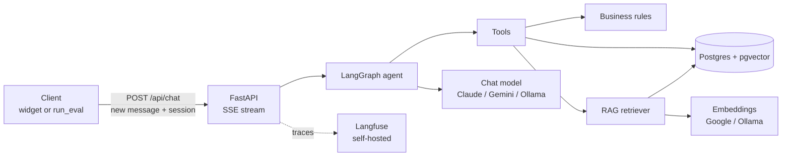
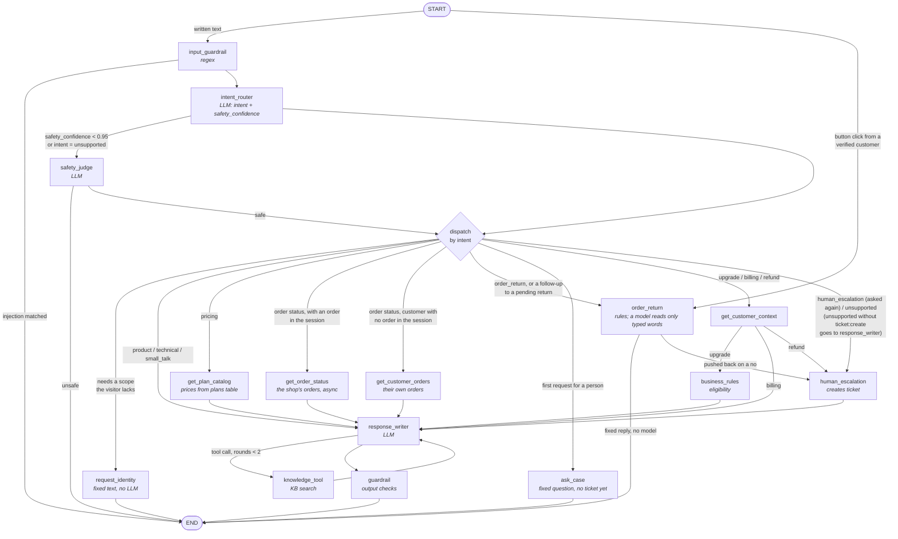

# Architecture

How a chat turn flows through the system, and where each responsibility lives. The
reasoning behind each choice is in the [architecture decision records](adr/README.md);
this page is the map.

## System

- The widget (`frontend/`, **Mew**) is one script that renders into an iframe on the shop's page
  and streams each turn over `fetch`; the shop's server vouches for a logged-in customer with a
  signed token ([ADR-0015](adr/0015-embeddable-widget-in-an-iframe.md)).
- A visitor has a session for a conversation, issued when it starts, when the shop vouches
  for a customer, or when a one-time code is verified; what they may do is a set of scopes
  ([ADR-0014](adr/0014-conversation-anchored-identity-with-scopes.md)).
- The server holds each conversation's messages in Postgres; a request carries only
  the new message, and every turn runs the graph from an empty state, started from
  the stored history ([ADR-0013](adr/0013-server-held-conversation-history.md)).
- One Postgres holds plans, customers, subscriptions, tickets and the embedded
  knowledge base ([ADR-0005](adr/0005-postgres-pgvector-for-rag.md)).
- The model provider is configuration, not code
  ([ADR-0004](adr/0004-provider-agnostic-llm-and-embeddings.md)).

## The agent graph

Reading it:

- **The LLM classifies, Python routes.** Every diamond and labeled edge is a plain
  function in `app/agent/routing.py`
  ([ADR-0001](adr/0001-langgraph-with-typed-state-and-deterministic-routing.md)).
- **Input safety is a cascade**: regex, then a score that comes free with intent
  classification, then a dedicated judge when that score is low or the intent is
  `unsupported` ([ADR-0007](adr/0007-input-safety-cascade.md)).
- **Commercial facts never come from the model.** Eligibility is computed in
  `business_rules`, prices are loaded by `get_plan_catalog`, an order's status is read by
  `get_order_status` from the one order the session proved (never from the message), and
  refunds have no tool and always reach a human
  ([ADR-0002](adr/0002-deterministic-business-rules-layer.md)).
- **Knowledge-base search is the only action the model chooses**, on the
  KB-answerable intents (billing included), at most two rounds per turn
  ([ADR-0006](adr/0006-llm-driven-knowledge-base-search.md)).
- **A button is not read by a model.** A click is a typed action (`input.type = "action"`), checked
  against the cards the last reply offered and applied by `order_return` from a table of the
  actions valid in each stage; it skips the input filter and the classifier
  ([ADR-0019](adr/0019-buttons-are-typed-actions-decided-by-rules.md)). Each turn of a return is
  recorded in `return_events` for outcome analysis
  ([ADR-0020](adr/0020-return-events-for-outcome-analysis.md)).
- **Every answer passes `guardrail`**, which replaces claims that state proves false
  ([ADR-0008](adr/0008-deterministic-output-guardrails.md)).

## Code layout

| Package | Responsibility | Depends on |
|---|---|---|
| `app/api` | HTTP and SSE: validation, streaming, tracing span, sessions, rate limits, allowed origins | `agent`, `auth`, `chat`, `core`, `schemas` |
| `app/auth` | Scopes, shop and session tokens, login, one-time codes, conversations | `db`, `core`, `schemas` |
| `app/orders` | An order's shape and where orders come from: an async `OrderSource` interface (reads, and cancelling or keeping an order), with a simulated table-backed implementation until the shop's API is wired | `business` (the retention rules), `db`, `schemas` |
| `app/chat` | A conversation's stored messages and the one-turn-at-a-time rule | `db` |
| `app/agent` | Graph, state, nodes, prompts, routing, permissions, LLM tool bindings | `tools`, `guardrails`, `auth` (scopes), `core`, `schemas` |
| `app/guardrails` | Input pattern checks, output claim checks | `schemas` |
| `app/tools` | Typed, framework-agnostic operations the agent calls | `business`, `rag`, `db`, `schemas` |
| `app/business` | Pure eligibility, pricing and upsell rules | `db` (models only), `schemas` |
| `app/rag` | Load, chunk, embed, ingest; similarity search | `core`, `db`, `schemas` |
| `app/db` | SQLAlchemy models, session, seed | `core` |
| `app/core` | Settings, model and embedding factories, tracing setup | nothing in `app` |
| `app/schemas` | Pydantic contracts shared across layers | nothing in `app` |
| `frontend/` | The Mew widget: loader, API client and conversation state, React UI | the HTTP API only |
| `evaluation/` | Dataset, evaluators, LLM judge, runner over HTTP | `app.schemas`, `app.core`, `app.db` |

Dependencies only point down this table, towards `schemas`
([ADR-0003](adr/0003-layering-and-dependency-direction.md)).

## One turn, end to end

1. The client posts the new message and a `message_id` with its session in the
   `Authorization` header; who is talking and in which conversation come from the
   session, not the body. The server opens the turn (one at a time per conversation,
   replaying the stored answer if the id was already handled) and starts the graph from
   the stored history and the session's scopes.
2. The graph runs; if the visitor lacks the scope the question needs, the turn ends with
   an identity request (a stored form, `identity_required` in `done`) and resumes through
   `POST /api/chat/resume` once they identify. Otherwise `response_writer`'s tokens
   stream to the client as `delta` events.
3. If `guardrail` rewrote the answer, a `correction` event carries the final text
   ([ADR-0010](adr/0010-stream-then-correct.md)).
4. A `done` event closes the turn with a typed summary (intent, escalation, ticket,
   flags, eligibility, identity request), read from graph state rather than from the text.
   The reply is stored in the conversation.
5. With tracing on, the whole turn is one Langfuse span, with every node, model call
   and tool call nested under it
   ([ADR-0011](adr/0011-self-hosted-langfuse-for-tracing.md)).

The evaluation suite is just another client of this flow
([ADR-0012](adr/0012-evaluation-against-the-real-api.md)).

## Data model

What the columns hold when the name alone does not say it (`backend/app/db/models.py`). Value
sets are stored as plain strings; the enums that produce them live in `app/schemas/` and
`app/business/`.

- **plans**: `billing_period` is `monthly` or `annual`.
- **tenants**: a shop that embeds the widget. `api_key` is public (it ships in the script URL) and
  only identifies the shop; proving a visitor takes a token signed with one of its
  `tenant_secrets`, several active at once so a shop can rotate, picked by `kid`. Those secrets are
  stored in the clear because HS256 needs the raw key (encrypting them is on the before-production
  list). `scope_overrides` maps an identity level to its scopes (levels left out keep the
  defaults), `allowed_origins` lists the pages the widget runs on (normalized, no wildcards), and
  `support_hours` is `{"timezone", "opens", "closes", "weekdays"}`, empty meaning always open.
- **tenant_smtp**: the mail server one-time codes go through; `security` is `starttls`, `ssl` or
  `none`, and the password is encrypted and write-only.
- **customers**: `tenant_id` and `external_id` (the `sub` of the shop's login token) link a customer
  to the shop that vouches for them; both are null for customers older than tenants. Emails are
  unique per tenant, not globally. `status` is `trial`, `active` or `churned`.
- **subscriptions**: a customer's commercial state over time, so plan changes keep their history;
  `status` is `active`, `canceled` or `past_due`.
- **conversations**: who is talking, anchored on the server; sessions, traces and security events
  use its id. `linked_via` is `store_login` or `otp_login`. `last_activity_at` is what a retention
  job will read; `turn_started_at` and `turn_id` mark a running turn. `handoff_status` is `none`,
  `waiting` or `active` (with `handoff_agent_name`, what the visitor sees). `pending_return_*`
  hold an unfinished return. The escalation lives here too: `escalation_route` (`live`,
  `offline`), `escalation_reason`, `escalation_category` (`escalation`, `refund`, `technical`,
  `billing`, `other`), `escalation_status` (`open`, `resolved`), and resolved ones move to
  `escalation_history`. `properties` and `tags` are public hints, never a reason to allow anything.
- **messages**: stored on the server so the client cannot forge the history. `role` is `user`,
  `assistant`, `human` (a person from the back office) or `system`; `kind` is `text`,
  `identity_request` or `system`, and anything but text is kept out of the model's history. A reply
  points at the message it answers with `reply_to_seq` (unique, so one reply per message);
  `author_name` is set only for a person; `cards` are stored so a reload shows them.
- **otp_challenges**: only an HMAC of the code, and the email normalized (stripped, lowercased).
- **security_events**: something for a person to review (too many wrong codes, too many requests);
  a signal, nothing is blocked by it.
- **identification_events**: one attempt to identify, with `method` (`otp`, `order_id`,
  `store_login`) and `outcome` (`code_sent`, `succeeded`, `failed`). No code, token, full email or
  full order id; `customer_id` only when a customer was proved.
- **return_events**: one row per turn through `order_return`, in the same transaction as the reply
  (ADR-0020). `input_type` is `action` (a button) or `text`; `stage_before` null means just asked,
  `stage_after` null means finished; `offer_*` is what was offered and `taken_*` what was recorded;
  `model` is what would have read a written message, kept for clicks too.
- **rate_limit_counters**: requests per key and fixed window, shared by every instance.
- **orders** and **order_adjustments**: the simulated stand-ins for the shop's orders API. An
  `order_id` is 20 alphanumeric characters, unique across tenants; `item_name` and `item_images`
  are set when the order is for a product rather than a plan. An adjustment (`refund_to_card` or
  `credits`) is what a customer took to keep an order, at most one per order; no money moves.
- **documents**: `source` is unique, so re-ingesting replaces a document and two concurrent runs
  cannot duplicate it; `plan_scope` null means every plan.
- **agent_presence**: back-office agents seen recently (ADR-0021).

`python -m app.db.seed` writes the dev tenant (a public key and secret, so local environments
only), restores its dev secret on every run in case a rotation test removed it, and allows the
example page's local origins (a page opened as a file has origin `null`, which is never allowed).
The demo customers each get one order, with amounts as charged, which are not always list prices;
their order ids are deterministic so docs and tests can name them.
